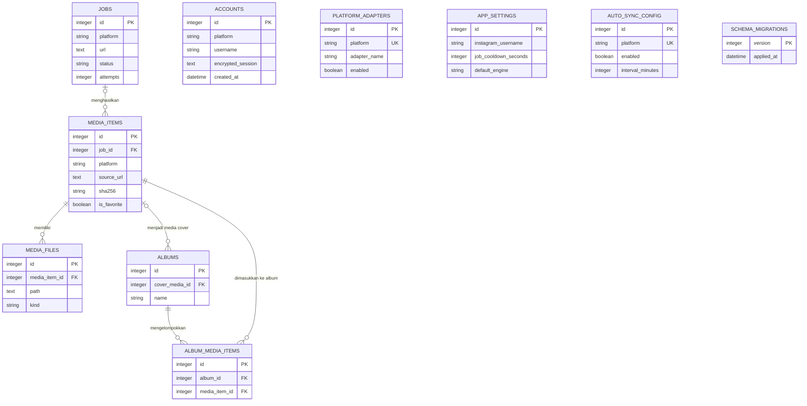

# Entity Relationship Diagram (ERD)

> **Document Type:** ERD 
> **Status:** Draft — model structure extracted from current source 
> **Owner:** [TBD — confirm with team] 
> **Last Updated:** 2026-10-19 
> **Source:** SQLAlchemy models and SQLite migration runner in [`backend/app/db.py`](../../backend/app/db.py#L46-L299); live user database was not inspected. 
> **Related Documents:** [SRS](./SRS.md), [Database Schema](../02-architecture/database-schema.md), [Data Dictionary](./data-dictionary.md), [Glossary](../glossary.md)

## 1. Gambaran umum database

MediaVault menyimpan unduhan sebagai job, metadata media, dan satu atau lebih file yang dihasilkan. Album mengatur kumpulan item media; tabel relasi album mencegah pasangan album-media ganda. Tabel konfigurasi menyimpan status adapter, preferensi aplikasi, autosync, dan akun platform.

Model di bawah berasal dari deklarasi SQLAlchemy ditambah tabel `schema_migrations` yang dibuat oleh runner migrasi. Struktur database lokal yang sudah ada dan riwayat migrasinya tidak diperiksa.

## 2. Logical data model / ERD

### Deskripsi entitas

| Entitas | Peran |
|---|---|
| `accounts` | Rekaman akun platform dan sesi terenkripsi. |
| `jobs` | URL dan status pemrosesan unduhan. |
| `media_items` | Metadata satu item hasil unduhan; dapat menunjuk job sumber. |
| `media_files` | File, thumbnail, dan atribut teknis yang terkait item media. |
| `albums` | Koleksi bernama opsional dengan cover item media. |
| `album_media_items` | Relasi album-item media; pasangan `(album_id, media_item_id)` unik. |
| `platform_adapters` | Nama adapter, engine, dan hasil health-check terakhir per platform. |
| `app_settings` | Preferensi aplikasi dan lokasi file cookies/session. |
| `auto_sync_config` | Pengaturan dan hasil terakhir auto-sync per platform. |
| `schema_migrations` | Versi migrasi SQLite yang tercatat. |

### Catatan relasi

- Satu job dapat memiliki nol atau beberapa `media_items`; `media_items.job_id` nullable.
- Satu item media dapat memiliki beberapa file. FK `media_files.media_item_id` tidak menetapkan aksi hapus cascade eksplisit.
- Album dapat memiliki banyak item melalui `album_media_items`; keanggotaan per pasangan unik. FK pada tabel relasi memakai `ON DELETE CASCADE`.
- Album dapat merujuk ke media cover lewat `albums.cover_media_id`; relasi ini tidak unik.
- Kode tidak mendeklarasikan FK antara `accounts` dan pengaturan/session Instagram.

## 3. Physical Data Model

The following names are the complete model/migration table inventory. Types, nullability and key annotations are itemized in the [Data Dictionary](../01-requirements/data-dictionary.md), from same source pass. Do not treat this declaration as proof of the local database's current live schema.

| Table | Columns |
|---|---|
| `accounts` | `id`, `platform`, `username`, `encrypted_session`, `created_at` |
| `jobs` | `id`, `platform`, `url`, `status`, `error`, `created_at`, `started_at`, `finished_at`, `lease_until`, `lease_token`, `next_attempt_at`, `attempts`, `progress_percent`, `bytes_downloaded`, `total_bytes`, `progress_stage`, `transfer_speed`, `eta_seconds` |
| `media_items` | `id`, `job_id`, `platform`, `source_url`, `username`, `caption`, `posted_at`, `hashtags`, `sha256`, `is_favorite`, `created_at` |
| `media_files` | `id`, `media_item_id`, `path`, `kind`, `sha256`, `thumbnail_path`, `width`, `height`, `duration`, `video_codec`, `audio_codec` |
| `albums` | `id`, `name`, `description`, `cover_media_id`, `created_at`, `updated_at` |
| `album_media_items` | `id`, `album_id`, `media_item_id`, `added_at` |
| `platform_adapters` | `id`, `platform`, `adapter_name`, `engine`, `engine_version`, `enabled`, `last_health_at`, `health_ok` |
| `app_settings` | `id`, `cookies_file`, `instagram_session_file`, `instagram_username`, `job_cooldown_seconds`, `default_engine` |
| `auto_sync_config` | `id`, `platform`, `enabled`, `sync_saved`, `sync_liked`, `interval_minutes`, `last_sync_at`, `last_sync_status`, `last_error`, `items_synced_total`, `last_discovered_count`, `last_enqueued_count`, `last_skipped_count`, `last_failed_count` |
| `schema_migrations` | `version`, `applied_at` |

**Related Documents:** [Kamus Data](./data-dictionary.md) lists meanings for every column above; [Database Schema](../02-architecture/database-schema.md) records indexes, uniqueness, migration history and defaults.
