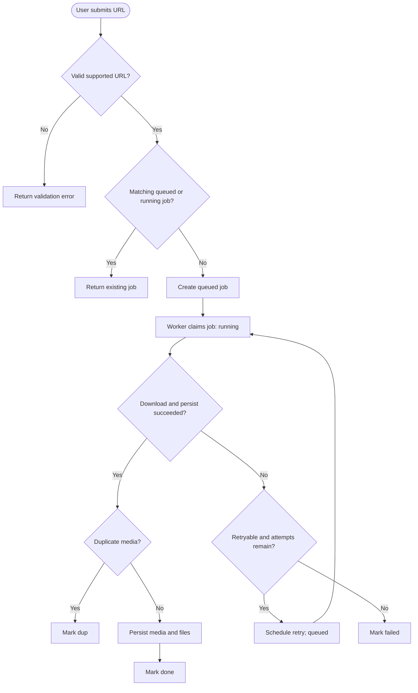
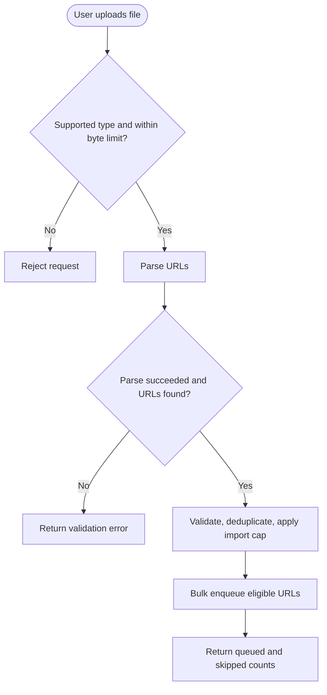
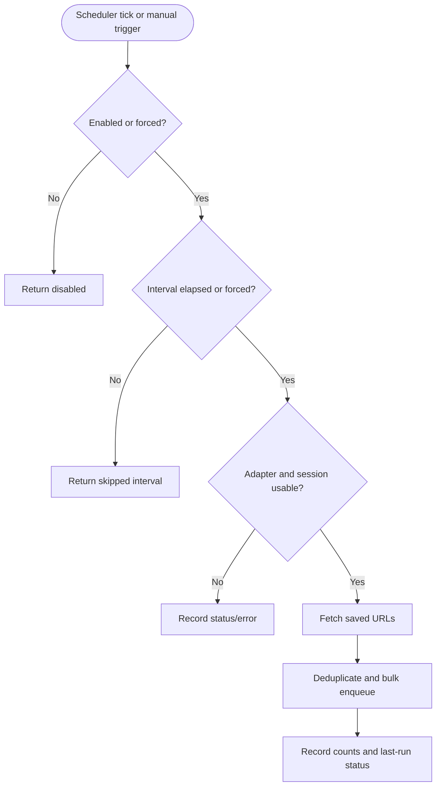

# Flowcharts

> **Document Type:** Flowcharts 
> **Status:** Draft — derived from implementation 
> **Owner:** [TBD — confirm with team] 
> **Last Updated:** 2026-10-19 
> **Related Documents:** [SRS](./SRS.md), [Use Cases](./use-cases.md), [LLD](../02-architecture/LLD.md), [Glossary](../glossary.md)

## 1. Download job

Retry count/backoff and recovery behavior are implementation details in [LLD](../02-architecture/LLD.md#download-worker). This diagram abstracts internal rollback and lease handling.

## 2. Archive import

Input types and limits are configurable. See [UC-002](./use-cases.md#uc-002-import-url-archive) and [API reference](../03-technical/api.md#import).

## 3. Saved Instagram synchronization

Implementation currently registers Instagram saved-post sync; it fetches up to 100 URLs per run, enqueues no more than 500, and forces liked-item sync off. See [UC-004](./use-cases.md#uc-004-sync-saved-instagram-posts).
