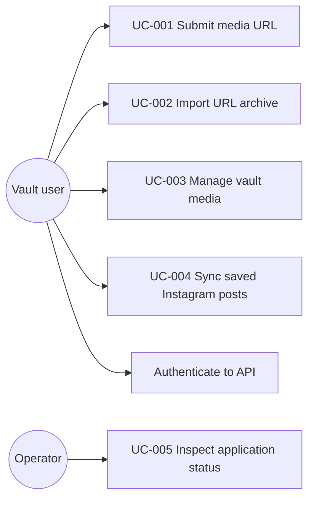

# Use Cases

> **Document Type:** Use Cases 
> **Status:** Draft — actors and behavior inferred from UI/API implementation 
> **Owner:** [TBD — confirm with team] 
> **Last Updated:** 2026-10-19 
> **Related Documents:** [BRD](./BRD.md), [SRS](./SRS.md), [Flowcharts](./flowcharts.md), [API reference](../03-technical/api.md), [Glossary](../glossary.md)

A use case describes observed application behavior, not an approved business policy. “User” means an authenticated local application user unless the endpoint is explicitly public.

## Actor overview

## UC-001: Submit media URL

> **Related BR / FR:** [BR-001](./BRD.md#br-001), [FR-001 and FR-002](./SRS.md#fr-001) 
> **Actor(s):** Vault user 
> **Status:** Draft — observed

**Description:** Queue one supported media URL for asynchronous download and view job progress.

**Preconditions:** Application is running; caller has valid bearer token or session; URL is accepted by platform validation.

**Main flow:**
1. User submits URL through Studio.
2. API validates and detects platform; an existing matching queued/running job may be returned rather than duplicated.
3. API records/queues job with `queued` status.
4. Worker claims it as `running`; adapter downloads to temporary storage and reports progress.
5. System calculates metadata/hash, moves downloaded files into the media root, stores media metadata, and sets job to `done`.
6. User sees updated job and media in Vault.

**Alternate / exception flows:** Invalid or unsupported URL returns validation error. Matching source/content is marked duplicate. Retryable rate-limit/network failure may be requeued; default maximum is three attempts with 30- then 60-second delays. Terminal/exhausted failure is marked `failed`. App restart recovers unfinished work or fails jobs already at retry limit.

**Postconditions:** Job result and any successfully downloaded media are persisted. Status names are defined in [Glossary](../glossary.md).

## UC-002: Import URL archive

> **Related BR / FR:** [BR-003](./BRD.md#br-003), [FR-003](./SRS.md#fr-003) 
> **Actor(s):** Vault user 
> **Status:** Draft — observed

**Description:** Upload a supported archive or Vidara URL list and enqueue extracted links.

**Preconditions:** Authenticated API access; file within configured size limit; supported extension.

**Main flow:**
1. User chooses archive import or Vidara text import.
2. System parses social URLs, validates supported format, and applies configured URL cap.
3. System bulk-enqueues valid, nonduplicate URLs.
4. UI displays imported, duplicate, invalid, and over-limit counts.

**Alternate / exception flows:** Unsupported extension, oversized upload, malformed file, invalid Vidara lines, or no valid URL returns an error; the API may include bounded invalid/skipped samples.

**Postconditions:** Accepted URLs create or reuse corresponding jobs.

## UC-003: Manage vault media

> **Related BR / FR:** [BR-002](./BRD.md#br-002), [FR-004](./SRS.md#fr-004) 
> **Actor(s):** Vault user 
> **Status:** Draft — observed

**Description:** Find media, mark favorites, organize items in albums, and export or delete selected content.

**Main flow:** User browses/searches/filters media or creators; may toggle a favorite, create/update/delete an album, add/remove media, download a media file/thumbnail, or export metadata/media as CSV, JSON, or ZIP.

**Alternate / exception flows:** Invalid/missing item or file returns an error. Export may reject empty selection or configured item/byte limit. Media paths outside configured root are not served.

**Postconditions:** Requested metadata/album changes are saved; exports are returned as downloads.

## UC-004: Sync saved Instagram posts

> **Related BR / FR:** [BR-004](./BRD.md#br-004), [FR-005](./SRS.md#fr-005) 
> **Actor(s):** Vault user 
> **Status:** Draft — observed

**Description:** Configure or manually trigger retrieval of saved Instagram URLs.

**Preconditions:** Instagram adapter is available; a valid Instagram session is configured for saved-post retrieval.

**Main flow:**
1. User configures sync enablement, saved-item collection, and interval in Settings/Studio.
2. Scheduler checks enabled Instagram sync periodically, or user triggers a forced sync.
3. Adapter retrieves saved URLs; system deduplicates and bulk-enqueues them.
4. User sees result and last-run counts/status.

**Alternate / exception flows:** Disabled or not-yet-due jobs are skipped. Missing/expired session, rate limiting, missing adapter capability, or fetch errors are recorded as sync status/error. Current implementation forces `sync_liked` off.

**Postconditions:** Newly accepted URLs are queued; sync result is recorded.

## UC-005: Inspect application status

> **Related BR / FR:** [BR-005](./BRD.md#br-005), [FR-006](./SRS.md#fr-006) 
> **Actor(s):** Operator 
> **Status:** Draft — observed

**Description:** Inspect download queue, adapter health, request/job metrics, and application event history.

**Main flow:** Operator opens Studio/Console, reads job and adapter status, filters event records, or follows the server-sent event stream.

**Alternate / exception flows:** Readiness reports not-ready when database check fails; event lookup for unknown event returns not found.

**Postconditions:** No business data change is required; observations reflect current application state.

**Related:** [Flowcharts](./flowcharts.md), [SRS](./SRS.md), [API](../03-technical/api.md).
