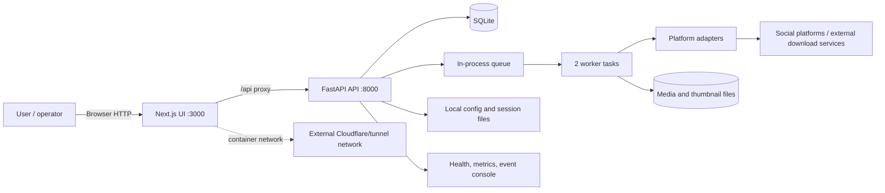

# High-Level Design (HLD)

> **Document Type:** HLD<br>
> **Status:** Draft — verified against repository source<br>
> **Owner:** [TBD — confirm with team]<br>
> **Last Updated:** 2026-10-19<br>
> **Related Documents:** [SRS](../01-requirements/SRS.md), [ERD](../01-requirements/ERD.md), [LLD](./LLD.md), [Database Schema](./database-schema.md), [Integrations](./api-integration.md), [Deployment](../03-technical/deployment.md), [Glossary](../glossary.md)

## 1. System overview

MediaVault is a single-instance local media downloader and library. A Next.js interface sends API requests to a FastAPI backend. The backend authenticates requests, validates media URLs, queues jobs for in-process workers, invokes platform adapters, records metadata in SQLite, and stores media files on disk. The interface supports browsing, import, albums, favorites, exports, settings, and operational views.

The codebase does not declare a supported hosted/multi-tenant service, durable distributed queue, retention contract, backup plan, or high-availability design. Treat those as **[TBD — confirm with team]**.

## 2. System context



In Compose, frontend publishes port 3000, backend exposes port 8000 only to its network, and frontend waits for the backend health check. Compose expects an already-created external network with default name `mediavault_tunnel`; tunnel service/configuration is not present in this repository.

## 3. Major components

| Component | Responsibility | Technology / source |
|---|---|---|
| Browser UI | Studio, login, vault, settings, console | Next.js App Router, React, TypeScript |
| API | Authentication middleware, REST routes, error envelope | FastAPI, Pydantic |
| Job orchestration | Validate, deduplicate, enqueue, recover, retry, progress | Python, in-process `asyncio.Queue`, APScheduler |
| Workers | Claim and process jobs; persist metadata and media files | Two worker tasks started by app lifespan |
| Platform adapters | Platform detection, download/resolve, health, optional saved-post sync | Native Python/HTTP and optional download engines |
| Persistence | Jobs, media metadata, albums, preferences, adapter/sync state | SQLAlchemy and SQLite by default |
| File store | Media, thumbnails, metadata sidecar, optional config/session | Filesystem under `MEDIA_ROOT` and configured paths |
| Diagnostics | Health/readiness, in-process metrics, structured events and stream | FastAPI endpoints, JSON logs, event store |

## 4. Technology stack

| Layer | Evidence-based implementation |
|---|---|
| Backend runtime | Python `>=3.11,<3.15`; FastAPI, Uvicorn, SQLAlchemy, Pydantic Settings |
| Frontend runtime | Next.js 16, React 19, TypeScript 5.7, Tailwind; Node 22 Docker image |
| Persistence | SQLite default; SQLAlchemy models; migration runner in `backend/app/db.py` |
| Download/media tooling | Optional `yt-dlp`, `gallery-dl`, `Instaloader`; FFmpeg/FFprobe used for media normalization/metadata |
| Background work | Two workers in one backend process; APScheduler in the same app lifecycle |
| Packaging | Dockerfiles and Docker Compose; local shell/PowerShell scripts |

Dependency versions and optional engines are declared in [`pyproject.toml`](../../pyproject.toml) and [`frontend/package.json`](../../frontend/package.json). Rationale for framework choices is **[TBD — confirm with team]**.

## 5. Data flow: media download

```mermaid
sequenceDiagram
    actor User
    participant UI as Next.js UI
    participant API as FastAPI
    participant DB as SQLite
    participant Q as In-process queue
    participant W as Worker
    participant A as Platform adapter
    participant FS as Media filesystem
    User->>UI: Submit source URL
    UI->>API: POST /api/jobs
    API->>API: Validate URL and detect platform
    API->>DB: Deduplicate active job / create queued job
    API->>Q: Enqueue job ID
    API-->>UI: Job ID and queued status
    Q->>W: Deliver job ID
    W->>DB: Claim job; status running
    W->>A: Download and resolve metadata
    A-->>W: Temporary files and post metadata
    W->>W: Hash and check duplicate content
    W->>FS: Organize media; create metadata/thumbnail
    W->>DB: Save media item/files; mark done
    UI->>API: Poll job and media list
    API-->>UI: Progress and final result
```

A retryable network/rate-limit failure can return a job to `queued` with a later retry time. Other failures or exhausted retries become `failed`. See [LLD: download worker](./LLD.md#download-worker).

## 6. Security and non-functional design

- Startup requires either configured API token or password hash plus session secret.
- API requests use bearer token or signed password-auth session; health and `/api/auth` routes are exceptions. `OPTIONS` is also skipped by the auth middleware.
- Compose mounts secret files read-only. Never place actual secrets, cookies, sessions, databases, or personal media in documentation or source control.
- Media file/thumbnail routes resolve paths and require them to remain inside configured media root.
- Work queue and metrics are in process; no external durable queue/cache is configured.
- TLS, network ACLs, production authentication choices, backup/recovery, media retention, service targets, and operational ownership are **[TBD — confirm with team]**.

## 7. Key architecture decisions observed

| Decision in code | Evidence / limitation |
|---|---|
| SQLite and local filesystem by default | Defaults in backend configuration and Compose bind mounts. No remote DB/store is configured by repository. |
| In-process background queue and scheduler | App starts worker tasks and APScheduler; no broker is configured. Jobs persist and recovery is attempted at startup. |
| Adapter boundary per platform | Registry dispatches URL detection/download through platform adapters; optional tools power some adapters. |
| Frontend proxy to backend | Next.js rewrites `/api/:path*` to `BACKEND_INTERNAL_URL`. |
| No production decisions implied | Hosting, scaling, backup, retention, and public ingress beyond declared Compose network remain unknown. |

For recorded design rationale on error classification, Vidara caching, and configuration precedence, see [ADRs](../adr/README.md).

## 8. Glossary

See [glossary](../glossary.md) for API, ORM, worker, queue, adapter, SQLite, and other terms.
