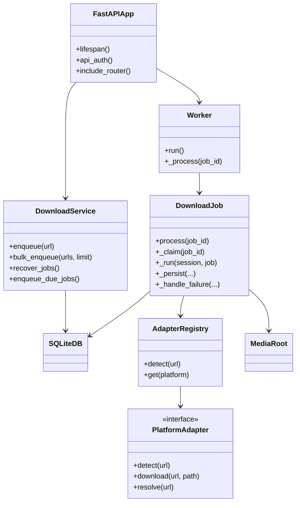
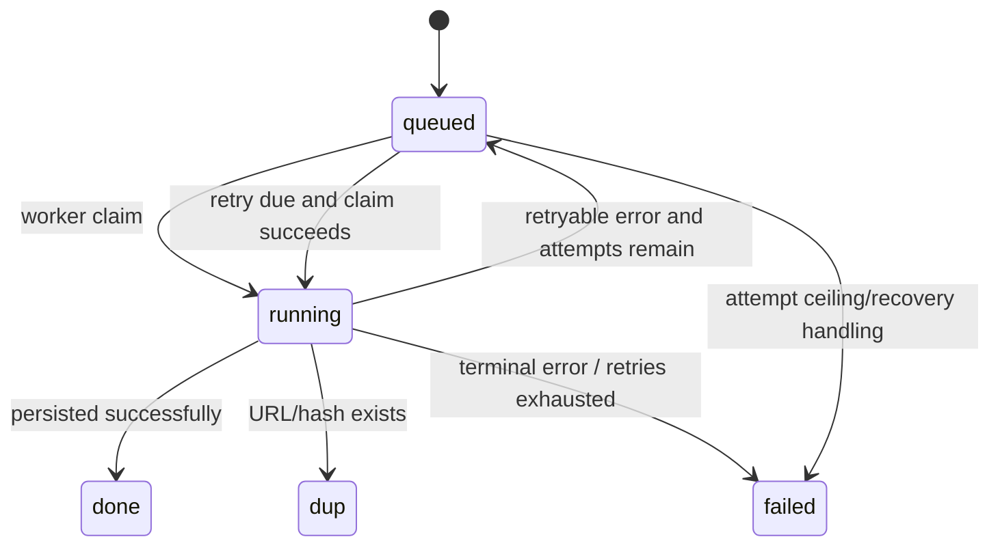

# Low-Level Design (LLD)

> **Document Type:** LLD<br>
> **Status:** Draft — reconstructed from current source<br>
> **Owner:** [TBD — confirm with team]<br>
> **Last Updated:** 2026-10-19<br>
> **Related Documents:** [HLD](./HLD.md), [SRS](../01-requirements/SRS.md), [Use Cases](../01-requirements/use-cases.md), [Database Schema](./database-schema.md), [API](../03-technical/api.md), [Glossary](../glossary.md)

## 1. Responsibility and boundaries

This document covers detailed backend behaviors for input validation, authentication, queue/download processing, local media storage, exports, settings, Instagram sessions and observability. [`Module Map`](./module-map.md) lists every backend source module and assigns responsibilities; this page expands complex interactions and cross-module invariants. HTTP handler behavior is listed in [API reference](../03-technical/api.md); schema in [Database Schema](./database-schema.md).

## 2. API bootstrap and authentication

`create_app()` loads cached settings, then refuses startup if neither an API token nor both password hash and session secret are configured. Lifespan calls `init_db()`, attempts job recovery, loads a configured Instagram session if its file exists, registers adapters, checks adapter health, starts the scheduler, and starts two queue workers. Shutdown cancels the worker task. Exception handlers convert validation errors into `invalid_request`, map known exceptions to a standard error envelope, and map uncaught exceptions to generic HTTP 500 while logging operator detail.

Middleware protects `/api/*` by comparing a bearer token with constant-time comparison or by verifying a signed session cookie. Public exceptions: `GET /api/health`, any `/api/auth*`, `OPTIONS`, and non-API paths. `/api/auth/me` performs its own session check. Password login checks a PBKDF2-SHA256 encoded hash, issues an HMAC-signed random cookie, and maintains failed-login/lockout counters in process memory. `valid_session()` checks issued-at TTL and last-seen idle timeout. The cookie's payload contains a last-seen field; this code does not refresh the cookie during ordinary requests.

## 3. URL validation and network boundary

`validate_url()` requires a nonempty already-trimmed URL; scheme is HTTPS; username/password are absent; port is absent or `443`; hostname exactly matches adapter host allowlist; every DNS answer is globally routable. Returned URL lowercases scheme/host, fills an empty path with `/`, and drops fragment. DNS lookup errors raise `HostResolutionError`; other invalid/unapproved/private-host cases raise `ValueError`.

Separate `validate_public_url()` / `open_public_url()` helpers allow HTTP/HTTPS and standard 80/443, check global DNS addresses and validate redirects. `open_public_url()` is used by TikTok's TikWM/data and direct media fallback; other adapter clients may implement their own request flow. DNS is checked then the client connects separately; code does not pin the verified IP. Treat this as an explicit limitation, not a DNS-rebinding guarantee.

## 4. Configuration and credential boundaries

`get_settings()` reads Pydantic settings from process environment and root `.env`, then `*_FILE` process environment indirection overrides API token, password hash, session secret, and vault key. The cached settings object does not auto-refresh if environment values change in-process. Database `app_settings` is a separate mutable UI settings row: Instagram identity/session path, cookie path, cooldown, and default engine. Readers may fall back to config values if DB settings are missing/unreadable. Do not infer identical precedence across every module: related precedence appears as a proposed/deferred ADR and call sites still perform reads.

Password authentication stores an encoded `pbkdf2_sha256$rounds$salt$derived-key` string; login checks it with `hmac.compare_digest`. Session cookie signature is HMAC-SHA256 using the configured session secret. Vault utility `encrypt`/`decrypt` uses Fernet and `VAULT_KEY`; it is separate from login password/session authentication. The default vault key is a placeholder and not valid Fernet material.

Cookies upload currently permits `cookies` with `.txt`/`.cookies`, requires Netscape marker, rejects empty/oversized content and overlong filename, writes random-name file under `config/uploads`, and updates settings row. Prior uploads are not automatically garbage-collected by this service. Instagram session upload validates nonblank username and bytes, writes random `.session` file with best-effort mode `0600`, tests it with adapter, commits new DB path/registers adapter, then removes old session file. Disconnect clears setting/deletes session file and registers a new empty adapter. Two-factor challenges are stored in memory, expire after 300 seconds, allow at most three failed attempts, and are consumed after successful login. These behaviors are process-local, not shared between replicas.

## 5. In-process work scheduling

Startup creates a module-level `asyncio.Queue[int]` and pending-ID set. `_push()` avoids IDs already pending; processing removes IDs from that set when consumed. `Worker` creates two worker loops and applies configured between-job cooldown. Queue state is not durable; DB records/recovery reconstruct due jobs after restart.

`AsyncIOScheduler` schedules adapter health every 30 minutes, Instagram auto-sync check every minute, and due retry dispatch every 5 seconds. Adapter health updates/inserts one `platform_adapters` row per registered adapter. Auto-sync respects persisted per-platform interval in addition to scheduler tick.

## 6. Component map



## 7. Module interfaces

| Module | Main entry points | Responsibility |
|---|---|---|
| `backend/app/main.py` | `create_app`, lifespan | Initialize DB, recover jobs, register adapters, start scheduler/workers, authenticate API. |
| `backend/app/service.py` | `enqueue`, `bulk_enqueue`, `recover_jobs`, `enqueue_due_jobs`, `claim_job` | Validate/detect and enqueue URLs; recover, lease and redispatch due work. |
| `backend/app/worker.py` | `Worker.run`, `Worker._process` | Consume job IDs; enforce configured cooldown; delegate job processing. |
| `backend/app/jobs.py` | `DownloadJob.process`, `_claim`, `_run`, `_persist`, `_handle_failure` | Claim job, download, detect duplicate, organize files, persist metadata, retry or finalize. |
| `backend/app/adapters/registry.py` | `AdapterRegistry.detect`, `get`, `all` | Dispatch URLs to registered platform adapters. |
| `backend/app/scheduler.py` | `start_scheduler` | Periodic adapter health check, auto-sync, and retry dispatch. |
| `backend/app/db.py` | `init_db`, `get_engine`, `get_session_factory` | Define SQLAlchemy schema, SQLite FK pragma, migrations and sessions. |

<a id="download-worker"></a>
## 8. Download worker

### Sequence

```mermaid
sequenceDiagram
    participant S as Service
    participant Q as asyncio.Queue
    participant W as Worker
    participant D as DownloadJob
    participant DB as SQLite
    participant R as AdapterRegistry
    participant A as Adapter
    participant FS as Media root
    S->>DB: Create queued job
    S->>Q: Push job ID
    Q->>W: Return job ID
    W->>D: process(job ID)
    D->>DB: Conditional claim; running, attempts + 1, lease
    D->>R: Detect adapter for URL
    D->>A: Download into temporary directory
    A-->>D: Downloaded paths
    D->>D: Hash and duplicate checks
    D->>A: Resolve creator/caption/date/tags
    D->>FS: Organize files and write metadata
    D->>DB: Insert media item and media file rows
    D->>DB: Mark done, progress 100%, clear lease
```

### Processing rules

1. `enqueue(url)` validates input and detects platform. It reuses a matching active job when one exists; otherwise creates `queued` record and pushes ID to the in-memory queue.
2. Worker claims a job only if status is `queued`, attempts are below the maximum, and `next_attempt_at` is due. Claim is a conditional database update; attempt count increments and lease token/time are set.
3. `DownloadJob` validates URL again, selects adapter, and checks URL-level duplication before downloading.
4. Download uses a temporary directory under media root. Progress callback updates downloaded/total bytes, stage, speed, ETA, and percentage.
5. System computes hashes. Existing SHA-256 match marks job `dup`. Otherwise the adapter resolves metadata; files are organized by platform/creator/date, metadata sidecar is written, and `MediaItem` plus `MediaFile` rows are persisted. Image/video thumbnail and probe metadata are best effort; `RuntimeError` during thumbnail generation does not prevent persistence.
6. Success marks status `done`, percentage `100`, stage `done`, finished time, and clears lease. No-file result or unsupported/invalid URL is terminal failure. Temporary directory is removed in `finally`.
7. On exception, moved files and sidecar are rolled back before error classification. Retryable categories currently include rate-limited and network errors. While attempts remain, status becomes `queued`; delay is `30 * 2^(attempts - 1)` seconds (30, 60, ...). Other/exhausted errors become `failed`.
8. Startup recovery requeues in-progress jobs where retry capacity remains; exhausted items are marked failed. Scheduler dispatches due pending jobs.

### State model



The status model is observed from current source; no promise is made that every UI action can cancel an already-running external download.

## 9. Media library and export

### Shared media query

`MediaQuery` is shared by list, count, creator aggregation, and exports. Supported filters: IDs, case-insensitive platform, creator (`unknown` means SQL NULL username), album, favorite flag, file kind, and substring search across caption/username/source URL/platform. Gallery ordering is created-at descending then item ID descending. Normal list serialization omits audio files; full/export serialization includes stored hashes/codecs and splits comma-stored hashtags. Query results include IDs, source/creator/caption/favorite/timestamps and file URL/name/type/dimensions/duration.

`available_visual=true` first queries items that have image/video DB rows, then walks DB rows in pages of 50 and checks that an image/video file exists. Offset is applied to files-present visual items. `count()` does not perform filesystem checks, so count and visual results can diverge. Creator aggregates use username+platform, report media/image/video counts, first/last `posted_at`, and up to four sample links per creator.

### Delete, favorites, and export

Favorite update is explicit if `is_favorite` is supplied; otherwise it toggles. Media deletion removes thumbnail path first, then attempts to unlink media bytes, deletes media-file/album association/media rows, removes sidecar and empty parent directories. Thumbnail filesystem exceptions may propagate; main file unlink and directory cleanup exceptions are suppressed. Filesystem/database operations are not atomic.

CSV fields are ID/platform/username/source/caption/hashtags/post/created/count/hash and UTF-8 BOM. Dangerous spreadsheet-leading `=`, `+`, `-`, `@` strings are prefixed with apostrophe. JSON uses full media serialization. ZIP enforces a byte cap across existing source files before zipping; absent file paths are omitted. It writes media under sanitized platform/username directories with item-ID prefix plus `metadata.json` and `metadata.csv`. Export buffer spills from memory to a temporary file beyond 8 MiB, then is read into bytes by route. Export filenames and content disposition are set by route.

## 10. Album and settings stores

Album service covers list/detail/create/update/delete and membership. Add path checks album exists, deduplicates valid media IDs before insert; DB unique constraint protects duplicate membership. Remove path deletes matching membership rows but current HTTP route does not check album existence first. Album delete cascades membership rows via FK when foreign keys are enabled.

`SettingsStore` uses singleton DB row ID 1. `snapshot()` returns internal file paths to trusted backend code; `serialize()` returns only existence flags for cookie/session paths, avoiding direct path disclosure to UI. Generic update changes only username/cooldown/engine.

## 11. Observability and event flow

Request middleware generates or reuses request ID, measures elapsed time, writes response header `X-Request-ID`, and logs method/path/status/duration. `/api/health` only returns liveness `ok`; `/api/health/ready` performs DB `SELECT 1`. `/api/metrics` reports in-memory request-status counts, queue depth, job counts, and accumulated job durations.

`MatrixConsole` keeps at most 2,000 events in a process-local ring buffer. Event payloads are deep-copied and selectively redact known secret-like fields, selected query params and bearer tokens. SSE subscribers use bounded queues of 100; a full queue drops its oldest event. Console log file rotates at 5 MiB with five backups. Redaction patterns are selective and do not guarantee removal of arbitrary sensitive strings from messages.

## 12. Import and bulk enqueue

- Archive parser accepts JSON, HTML, HTM and TXT; Vidara import accepts TXT. Upload size, parser limits and enqueue cap are configurable.
- Parsers extract URLs, then bulk enqueue classifies invalid links, duplicates, over-limit links, and accepted job IDs.
- Endpoint validation/response details: [API reference — import](../03-technical/api.md#import).

## 13. Adapter boundary and supported registrations

`BaseAdapter` defines detection, download, metadata resolution and optional health/session/saved-item capabilities. Startup registers Instagram, X, Threads, YouTube, Reddit, Pinterest, TikTok, and Vidara. Facebook adapter exists but is commented out in registration. Instagram login/session flow and auto-sync are specialized. Download engine and platform facts: [API integration](./api-integration.md).

## 14. Error handling and persistence safety

- FastAPI maps request validation, HTTP and application errors to a consistent error response; unexpected exceptions return HTTP 500.
- Download errors normalize to categories (`rate_limited`, `challenge_required`, `session_expired`, `network_error`, credential/session/download/storage/URL/media errors, and `unknown_error`); only `rate_limited` and `network_error` are retryable according to `download_errors.py`. Classification currently uses ordered text-substring matching.
- API error envelope includes user/operator messages, severity, status, retryable flag, remediation, and request ID. Exception mapper handles common HTTP statuses and presents other uncaught failures generically as `internal_error`.
- Path serving constrains requested files to media root. Authentication is applied at API middleware, with explicit health/auth/preflight exceptions.
- File rollback occurs on exceptional processing paths. Database/filesystem are not a single atomic transaction; crash consistency and recovery limits remain an operational concern.
- Retry/idempotency, external rate limits, migration rollback, backups, and retention beyond observed behavior are [TBD — confirm with team].
