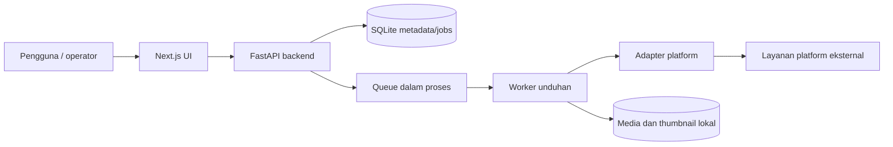

# Arsitektur Sistem — Ringkasan

> **Document Type:** System Architecture 
> **Status:** Draft — plain-language summary derived from code 
> **Owner:** [TBD — confirm with team] 
> **Last Updated:** 2026-10-19 
> **Related Documents:** [HLD](../02-architecture/HLD.md), [LLD](../02-architecture/LLD.md), [Deployment](./deployment.md), [API](./api.md), [Glossary](../glossary.md)

## Apa fungsi sistem ini?

MediaVault mengambil media dari URL platform sosial yang didukung, menyimpan file di media root lokal, dan membuat katalog yang dapat dicari serta diatur ke album/favorites. Aplikasi menyediakan browser UI dan API untuk pengunduhan serta pengelolaan katalog.

## Bagaimana bagian-bagiannya bekerja bersama?

Antarmuka meneruskan permintaan `/api/*` ke backend. API mengelola autentikasi dan data; worker menjalankan unduhan di latar belakang agar request UI cepat selesai. Metadata berada di SQLite, file media di direktori filesystem. [HLD](../02-architecture/HLD.md) menjelaskan komponen teknis lebih lengkap.

## Satu siklus permintaan

Saat pengguna mengirim URL, UI membuat job melalui API. Backend memvalidasi URL, menemukan adapter, menghindari job aktif ganda, lalu memasukkan ID job ke antrean in-process. Worker mengklaim job, mengunduh ke folder sementara, memeriksa duplikat, memindahkan file ke lokasi teratur, lalu menyimpan metadata. UI membaca status/progress dan memuat media yang berhasil. Gangguan network/rate limit dapat menjadwalkan retry; status akhir terlihat di antrean.

## Cari kode berdasarkan kebutuhan

| Jika ingin… | Buka… |
|---|---|
| Memahami tujuan dan requirement | [BRD/SRS](../01-requirements/README.md) |
| Memahami komponen arsitektur | [HLD](../02-architecture/HLD.md) |
| Mengubah pipeline unduhan | [LLD](../02-architecture/LLD.md) |
| Meninjau tabel dan kolom | [Database Schema](../02-architecture/database-schema.md) |
| Mengintegrasikan API/platform | [API reference](./api.md), [API integration](../02-architecture/api-integration.md) |
| Menjalankan aplikasi | [Deployment guide](./deployment.md) |
| Mengoperasikan/memeriksa layanan | [SOP](./sop.md) |

## Batasan yang diketahui

Queue dan scheduler berada di proses backend; restart membutuhkan pemulihan dari DB dan bukan antrean broker terdistribusi. File/media/DB disimpan lokal berdasarkan konfigurasi. Arsitektur hosting, backup, retensi, dan ketersediaan production **[TBD — confirm with team]**.
